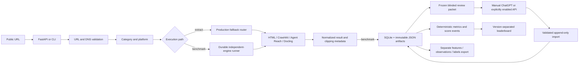
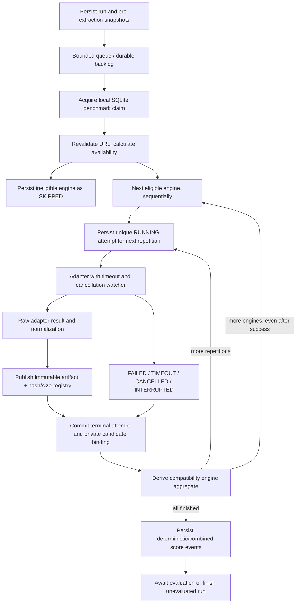
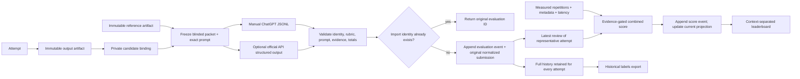
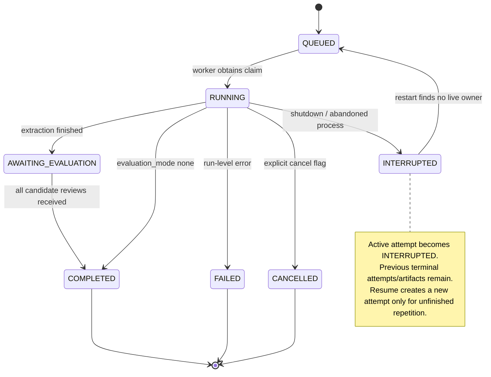

# Implemented data flows (schema 3, history layout from schema 2)

## A. System architecture

## B. Independent engines and repetitions

## C. AI scoring and history

## D. Cancellation and recovery

Attempt states additionally distinguish COMPLETED, PARTIAL, FAILED, TIMEOUT and SKIPPED. A successful HTTP/API call is not proof of complete or high-quality extracted content.
