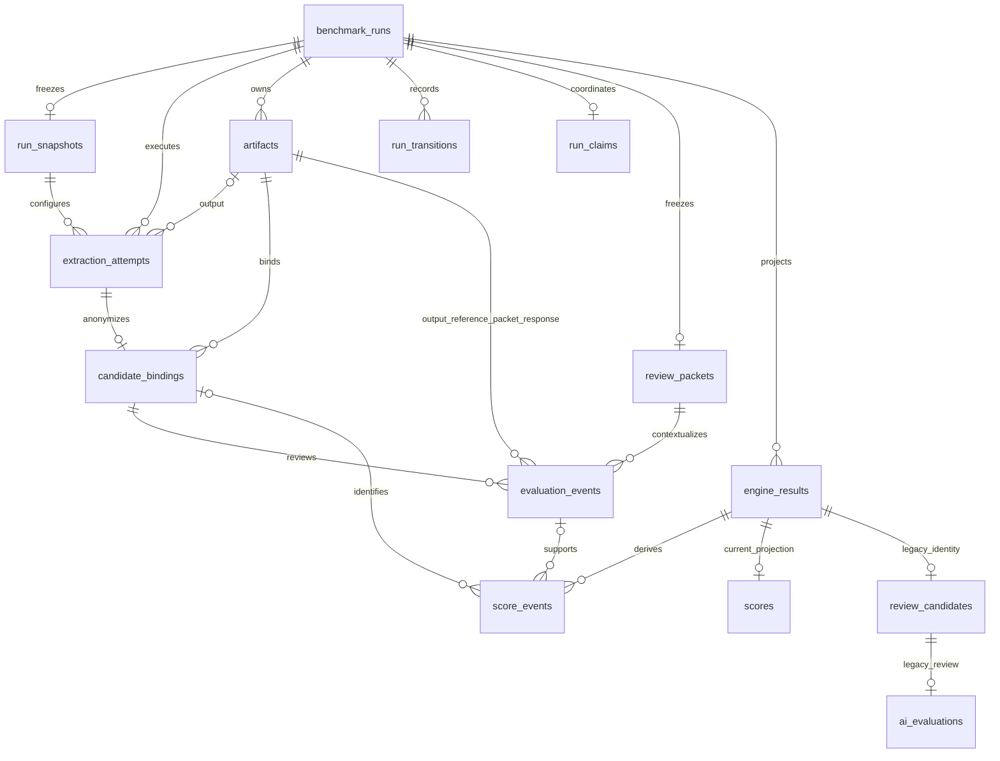

# SQLite schema 3

Schema authority is `experiment_store.py` (legacy tables) and `storage_v2.py` (additive schema 2 plus schema 3 context guards). Table columns were inspected from the migrated `.benchmark_lab/experiments.sqlite3`; schema 3 adds triggers without changing these columns. Foreign keys are enabled on every store connection. WAL is enabled. Timestamps are ISO-8601 UTC TEXT; JSON is TEXT. New history JSON fields have `json_valid` checks.

## ER diagram



The legacy review relationship is protected by a context trigger, not a declared candidate-ID FK. Regression run parents are protected by triggers. `migration_log` and `legacy_records` are independent migration/archive tables without a physical FK between them. Composite foreign keys on new records enforce same-run attempt/artifact/candidate/evaluation relationships. An attempt may have no artifact (failure, timeout, skip or interruption). The diagram summarizes roles; exact constraints follow.

## Authoritative history tables

| Table | Columns and SQLite types | Purpose, writer, ML role |
|---|---|---|
| `run_snapshots` | `run_id TEXT PK/FK`, `captured_at TEXT`, `config_json TEXT`, `environment_json TEXT`, `features_json TEXT`, `rubric_version TEXT`, `rubric_json TEXT`, `provenance TEXT` | Store creates once before extraction; freezes routing-time inputs, limits/versions and exact rubric definition |
| `artifacts` | `id TEXT PK`, `run_id TEXT FK`, `path TEXT UNIQUE`, `sha256 TEXT`, `byte_size INTEGER`, `created_at TEXT`, `kind TEXT`, `schema_version TEXT`, `encoding TEXT`, `content_type TEXT`, `provenance TEXT` | Store registry of immutable JSON bytes; hashes allow later verification; legacy files are registered without changing bytes |
| `extraction_attempts` | `id TEXT PK`, `run_id TEXT FK`, `engine TEXT`, `engine_version TEXT`, `backend TEXT`, `repetition INTEGER`, `state TEXT`, `started_at TEXT`, `completed_at TEXT`, `duration_seconds REAL`, `extraction_status TEXT`, `error_type TEXT`, `error TEXT`, `artifact_id TEXT`, `output_chars INTEGER`, `truncation_json TEXT`, `metadata_json TEXT`, `resources_json TEXT`, `provenance TEXT`, `snapshot_id TEXT FK` | Runner writes one row per execution, then terminalizes once; records successful, partial, failed, timed-out, skipped, cancelled and interrupted observations |
| `candidate_bindings` | `candidate_id TEXT PK`, `run_id TEXT`, `attempt_id TEXT`, `artifact_id TEXT` | Runner assigns anonymous identity to the exact output of an attempt; joins labels to actual bytes |
| `review_packets` | `run_id TEXT PK/FK`, `artifact_id TEXT`, `prompt_version TEXT`, `prompt_sha256 TEXT`, `rubric_version TEXT`, `reference_artifact_id TEXT`, `created_at TEXT` | Evaluator export freezes one packet per finished run; artifact contains packet and full prompt |
| `evaluation_events` | `id TEXT PK`, `run_id TEXT FK`, `candidate_id TEXT`, `attempt_id TEXT`, `artifact_id TEXT`, `reference_artifact_id TEXT`, `packet_artifact_id TEXT`, `response_artifact_id TEXT`, `evaluator_type TEXT`, `evaluator_model TEXT NULL`, `prompt_version TEXT`, `rubric_version TEXT`, `imported_at TEXT`, `evaluated_at TEXT NULL`, `idempotency_key TEXT UNIQUE`, `ai_score REAL NULL`, `status TEXT`, `score_json TEXT` | Import appends events; score JSON contains all four dimensions, evidence, confidence, omissions, claims and submitted total; every review remains traceable |
| `score_events` | `id TEXT PK`, `run_id TEXT FK`, `engine_result_id INTEGER FK`, `candidate_id TEXT NULL`, `evaluation_id TEXT NULL`, `rubric_version TEXT`, `calculation_version TEXT`, `created_at TEXT`, `evidence_json TEXT`, `score_json TEXT`, `event_hash TEXT UNIQUE` | Scoring appends changed derivations; evidence includes attempt input set/reference/snapshot/selection policy; score JSON includes individual deterministic/AI/final metrics, missing reasons and status |
| `run_transitions` | `id TEXT PK`, `run_id TEXT FK`, `state TEXT`, `occurred_at TEXT`, `error TEXT NULL` | Append-only lifecycle audit; preserves extraction/evaluation status transition times separately from current run status |
| `legacy_records` | `source_table TEXT`, `row_key TEXT`, `payload_json TEXT`, `provenance TEXT`; composite PK `(source_table,row_key)` | Migration archives original legacy rows verbatim; unknown old data is not invented into current attempt/snapshot records |
| `migration_log` | `version INTEGER PK`, `applied_at TEXT`, `details TEXT` | Records applied migration and legacy provenance rule |

### Referential and validation rules

- `artifacts`: `UNIQUE(run_id,id)`; SHA-256 length 64; nonnegative byte size; parent run FK.
- `extraction_attempts`: `UNIQUE(run_id,id)` and `UNIQUE(run_id,id,artifact_id)`; `(run_id,artifact_id)` FK to artifacts; snapshot FK. Repetition, count and duration are nonnegative. State is constrained to the implemented attempt states. Repetition 0 identifies an eligibility skip.
- `candidate_bindings`: unique `(run_id,candidate_id)` and `(run_id,candidate_id,attempt_id,artifact_id)`; composite FK `(run_id,attempt_id,artifact_id)` to the exact attempt output, and `(run_id,artifact_id)` to artifacts. Cross-run and wrong-output bindings are rejected by SQLite.
- `review_packets`: same-run output/reference artifact FKs; one immutable packet per run in this version.
- `evaluation_events`: run FK to review packet; composite candidate/run/attempt/artifact FK; same-run reference, packet and response artifact FKs. AI total is NULL or 0–60. Status and evaluator type are checked. Per-dimension ratings and totals are validated at import with Pydantic and the scoring function. Model may be NULL when unknown.
- `score_events`: run/result IDs checked by FK plus context trigger; optional same-run candidate/evaluation composite FKs. A null evaluation is valid for unevaluated deterministic observations.

`run_snapshots`, `artifacts`, `candidate_bindings`, `review_packets`, `evaluation_events`, `score_events`, `legacy_records` and `run_transitions` reject UPDATE and DELETE. An attempt may transition from RUNNING once; terminal attempt updates and all deletes are rejected. Existing SQLite files are not OS-level immutable: read-time hashes detect file tampering, and filesystem permissions restrict access.

## Mutable control and compatibility tables

| Table | Columns and types | Purpose / writer |
|---|---|---|
| `benchmark_runs` | `id TEXT PK`, `url TEXT`, `category TEXT`, `status TEXT`, `evaluation_mode TEXT`, `dataset_version TEXT`, `rubric_version TEXT`, `repetitions INTEGER`, `requested_engines_json TEXT`, `tags_json TEXT`, `reference_artifact TEXT`, `reference_metadata_json TEXT`, `reference_source TEXT`, `reference_verified INTEGER`, `reference_notes TEXT`, `error TEXT`, `cancel_requested INTEGER`, `created_at TEXT`, `started_at TEXT`, `completed_at TEXT`, `updated_at TEXT` | Parent and current control state; API/CLI/store/runner. Immutable snapshots/history supplement this legacy layout |
| `engine_results` | `id INTEGER PK`, `run_id TEXT FK`, `engine TEXT`, `engine_version TEXT`, `backend TEXT`, `state TEXT`, `extraction_status TEXT`, `started_at TEXT`, `completed_at TEXT`, `latency_seconds REAL`, `attempts INTEGER`, `successes INTEGER`, `output_chars INTEGER`, `artifact_path TEXT`, `metadata_json TEXT`, `final_url TEXT`, `title TEXT`, `error TEXT`, `attempt_details_json TEXT`, `cpu_seconds REAL`, `rss_before_bytes INTEGER`, `rss_after_bytes INTEGER` | Runner's derived current engine summary; unique `(run_id,engine)`; never a replacement for attempt history |
| `scores` | `run_id TEXT`, `engine_result_id INTEGER`, `rubric_version TEXT`, `metadata_score REAL`, `reliability_score REAL`, `latency_score REAL`, `deterministic_score REAL`, `ai_score REAL`, `final_score REAL`, `status TEXT`, `reasons_json TEXT`, `updated_at TEXT`; composite PK `(run_id,engine_result_id)` | Current compatibility score projection; immutable score_events retain history |
| `review_candidates` | `run_id TEXT`, `engine_result_id INTEGER`, `candidate_id TEXT UNIQUE`, `created_at TEXT`; composite PK `(run_id,engine_result_id)` | Original aggregate candidate mapping, retained for historical reads; new exports use candidate_bindings |
| `ai_evaluations` | `id INTEGER PK`, `run_id TEXT`, `engine_result_id INTEGER`, `candidate_id TEXT`, `fidelity REAL`, `completeness REAL`, `structure REAL`, `grounding REAL`, `ai_score REAL`, `status TEXT`, `confidence TEXT`, `missing_json TEXT`, `unsupported_json TEXT`, `evidence_json TEXT`, `notes TEXT`, `evaluator_model TEXT`, `prompt_version TEXT`, `created_at TEXT` | Original latest-review table; retained but no longer written by the new import path |
| `regressions` | `id INTEGER PK`, `run_id TEXT`, `previous_run_id TEXT`, `engine TEXT`, `metric TEXT`, `old_value REAL`, `new_value REAL`, `direction TEXT`, `severity TEXT`, `details TEXT`, `created_at TEXT` | Recomputed compatibility comparison against matching URL/category/dataset/rubric history |
| `run_claims` | `run_id TEXT PK/FK`, `owner TEXT`, `claimed_at TEXT` | Runner/manager coordination; owner is local PID plus UUID token; dead owner recovery releases it |

Original legacy foreign keys and unique constraints remain. Triggers now reject cross-run legacy candidate/score/evaluation records and invalid regression parents. Engine count/duration/JSON constraints and basic run timestamp/state constraints also apply to future writes. `run_claims` has a unique constant-expression index so only one benchmark holds the local database-wide execution slot. This is local coordination, not a distributed lease service.

## Indexes

| Index | Columns / purpose |
|---|---|
| `idx_runs_category` | `benchmark_runs(category,status)` |
| `idx_results_engine` | `engine_results(engine,state)` |
| `idx_scores_status` | `scores(status)` |
| `idx_attempt_history` | `extraction_attempts(run_id,engine,repetition)` |
| `idx_attempt_version` | `extraction_attempts(engine,engine_version,state)` |
| `idx_eval_history` | `evaluation_events(run_id,candidate_id,imported_at)` |
| `idx_scores_context` | `score_events(run_id,rubric_version,engine_result_id)` |
| `idx_runs_history` | `benchmark_runs(url,category,dataset_version,created_at)` |
| `idx_single_benchmark_worker` | Unique constant expression on `run_claims`, serializes local benchmark jobs |

Primary/unique constraints additionally generate SQLite indexes.

## One run, many observations

Illustrative cardinalities, not live benchmark results:

| Entity | Example: two engines, three repetitions, two reviews of one output |
|---|---:|
| Benchmark parent | 1 |
| Frozen snapshot | 1 |
| Independent attempts | 6 |
| Output artifacts | Up to 6, plus any safely retained failure outputs |
| Candidate bindings | One per returned output |
| Reference artifact | 0 or 1 in the current run API |
| Frozen packet artifact | 1 after export |
| Evaluation events | 2; neither overwrites the other |
| Response artifacts | One per import (including safely retained repeated submissions) |
| Score history | Baseline derivations plus changed evaluation-derived versions |
| Current engine/score projections | Up to 2 of each |

## Migration, backup and rollback

Schema version is `PRAGMA user_version`; application rejects newer unsupported versions. Before upgrading a store below version 3, initialization creates a SQLite backup and copies artifacts into `<data_root>/backups/<UTC timestamp>/`. Migration 2 creates additive tables/indexes/triggers, archives existing legacy rows, and registers old artifact bytes with provenance `legacy_unknown`. Migration 3 adds same-run snapshot, timestamp, packet/reference, score/evaluation-engine and rating guards. Each migration is transactional and logged. Neither deletes old tables/files or fills unavailable measurements with guesses.

The additional pre-change backup from this task is:

```text
storage-backups/20261105T101347069562Z/
  experiments.sqlite3
  artifacts/
  manifest.json
```

Its database integrity and every manifest checksum were checked. An isolated restore was migrated and compared row-for-row; the original database was then migrated with identical preservation checks.

Rollback must preserve new work: stop the API/CLI workers, take another consistent backup, and restore the old backup into a **new directory**, never over the active store. Point `BENCHMARK_DATA_DIR` to that restored directory and use the pre-hardening application version to inspect it; the current application will automatically migrate a v1 copy. Keep the v2 directory as historical evidence. Use SQLite's backup API rather than copying only a live WAL database file.

Files and SQL cannot share one atomic transaction. Publication failures may leave a fully written orphan; `storage-integrity` lists it. Investigate recorded attempt/run associations and compare hashes before any manual recovery. No cleanup command deletes staged/orphan files automatically. A valid database plus complete artifact directory is the unit of backup and restoration.
