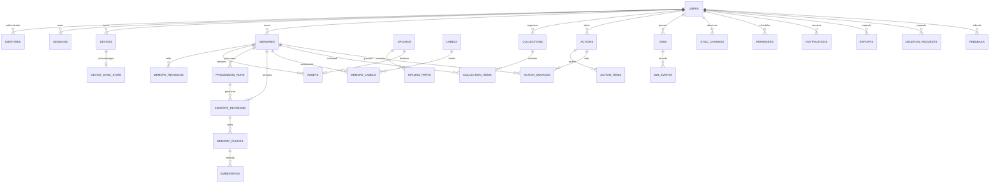

# RecallBox product database design

Proposed logical schema, 7 November 2026, baseline `c1ef5ed`. **Not an applied migration.** Product storage is a separate PostgreSQL database with pgvector. Existing benchmark SQLite schema 3 and artifacts remain private and unchanged; never copy user memories into immutable benchmark history. Existing schema authority remains `experiment_store.py` / `storage_v2.py`, documented in [DATABASE_SCHEMA.md](DATABASE_SCHEMA.md).

## Core relations and ownership

Use UUID identifiers, `timestamptz` UTC, bounded text/JSON, checked status enums and explicit version integers. Every user-owned row has `owner_id NOT NULL`. Each referenced owned parent exposes `UNIQUE(owner_id,id)`; child composite FKs reference that pair, preventing cross-account associations even when IDs are guessed. Clients cannot supply owner IDs. Use explicit column allowlists to prevent mass assignment. All tables below are proposed.

| Table | Key columns / constraints / purpose |
|---|---|
| users | `id PK`, status(active/deleting/deleted), display_name, created_at, deleted_at, sync_sequence bigint default 0; no raw password in the baseline OIDC model |
| identities | `id PK`, owner_id→users, issuer, subject; `UNIQUE(issuer,subject)`; minimum provider metadata, not full provider token dumps |
| sessions | id, owner_id, family_id, device_id nullable, refresh_hash UNIQUE, expires_at, revoked_at, replaced_by, created_at; refresh tokens random and hashed, never plaintext |
| devices | id, owner_id, client_device_id, platform, push_token encrypted, last_seen_at, revoked_at; `UNIQUE(owner_id,client_device_id)`; token rotation and per-device logout |
| notification_preferences | owner_id PK, enabled, timezone, quiet_hours JSON checked; opt-in settings, no content in push |
| memories | id, owner_id, kind(url/note/image/pdf/video), source_url nullable, title, user_note, state, coverage, current_content_revision_id nullable, version, starred, archived, created_at, updated_at, deleted_at; kind/field checks and same-memory current-revision binding |
| memory_revisions | id, owner_id, memory_id, entity_version, mutation_kind, bounded user fields JSON, created_at; `UNIQUE(owner_id,memory_id,entity_version)`; user-visible edit/conflict history, purged with memory |
| assets | id, owner_id, memory_id nullable, upload_id, storage_key UNIQUE, sha256, actual_bytes, detected_type, page_count/pixels/duration nullable, state, created_at, deleted_at; nonnegative limits, `UNIQUE(owner_id,upload_id)` |
| uploads | id, owner_id, memory_id nullable, expected_bytes, received_bytes, reserved_bytes, checksum, state, expires_at, part_size; per-user quota reservation before receiving bytes; generated paths only |
| upload_parts | id, owner_id, upload_id, part_number, bytes, sha256, staged_key; `UNIQUE(owner_id,upload_id,part_number)`; reject inconsistent repeat bytes/checksum; max total parts |
| processing_runs | id, owner_id, memory_id, input_version, processor_version, model_versions JSON, engine, coverage, truncation JSON, state, safe_error_code, started_at, completed_at; actual provenance, not benchmark ratings |
| content_revisions | id, owner_id, memory_id, processing_run_id, representation(text/ocr/transcript/structured), language, content_key or bounded inline_text, source_locator JSON, sha256, truncated, created_at; `UNIQUE(owner_id,memory_id,id)` for current pointer |
| memory_chunks | id, owner_id, memory_id, content_revision_id, ordinal, text, token_count, source_locator JSON, search_document tsvector; unique revision/ordinal, source page/time/character offsets |
| embeddings | id, owner_id, chunk_id, model_id, model_revision, dimension checked=384, embedding vector(384), created_at; `UNIQUE(owner_id,chunk_id,model_id,model_revision)`; fixed dimension migration for another model |
| labels | id, owner_id, name, normalized_name; `UNIQUE(owner_id,normalized_name)` |
| memory_labels | id, owner_id, memory_id, label_id, source(rule/model/user), confidence nullable checked 0..1, model_version nullable; unique owner/memory/label; user override survives reprocessing |
| collections | id, owner_id, name, description, version, deleted_at, timestamps |
| collection_items | id, owner_id, collection_id, memory_id, position, version; `UNIQUE(owner_id,collection_id,memory_id)`, checked position; reorder uses collection version |
| actions | id, owner_id, kind(recipe/travel/learning), title, schema_version, bounded typed payload JSON, version, deleted_at, timestamps; validate payload against kind, no executable instructions |
| action_sources | id, owner_id, action_id, memory_id, content_revision_id nullable, locator JSON; source references same memory, not merely same owner |
| action_items | id, owner_id, action_id, kind, position, checked/completed state, typed bounded payload, version; recipe quantities use decimal plus unit, travel stores IANA timezone/date, learning progress checked |
| jobs | id, owner_id, memory_id nullable, kind, stage, input_version, state, attempts, available_at, lease_until, lease_token bigint, worker_id, heartbeat_at, cancel_requested, safe_error_code, created_at; dedupe unique owner/kind/entity/version/stage |
| job_events | id, owner_id, job_id, transition, safe_error_code, duration_ms, created_at; bounded diagnostic lifecycle, no source text; deletable user data |
| idempotency_keys | owner_id, key, route, request_hash, response_status, response_entity_id, expires_at; composite PK owner/route/key, body mismatch →409, scoped to session-independent account |
| quota_usage | owner_id, period_start, saves, pending_jobs, stored_bytes, reserved_bytes; atomic counters, checked nonnegative, compare against active objects in reconciler |
| sync_changes | owner_id, sequence, entity_kind, entity_id, version, operation, changed_at; PK(owner_id,sequence); include deletion tombstones, bounded retention |
| device_sync_state | owner_id, device_id, last_ack_sequence, last_seen_at; one row/device; stale devices must full resync |
| reminders | id, owner_id, action_id nullable, memory_id nullable, next_fire_at, timezone, recurrence bounded JSON, state, version; require valid target, cancel on deletion |
| notifications | id, owner_id, device_id nullable, target_kind/id, kind, read_at, delivery_state, receipt_id, created_at; no private preview payload sent externally |
| outbox_events | id, owner_id, kind, entity_id, unique_dedupe_key, available_at, lease_until, lease_token, attempts, state; transactional push/email-free event delivery, no content |
| exports | id, owner_id, state, encrypted archive_key, expires_at, created_at; authenticated short-lived download, no public URL |
| deletion_requests | id, owner_id, target_kind/id, state, requested_at, primary_purged_at, backup_expiry_at, safe_error_code; immediate access suppression before asynchronous purge |
| deletion_ledger | opaque target IDs, deletion_epoch, expires_at; restricted system table, encrypted off-device copy; minimal restore suppression evidence retained 90 days, no original content |
| feedback | id, owner_id, memory_id nullable, category, user_text, diagnostic_content_consent, state, created_at; no automatic training/lab export |
| audit_events | id, actor_id nullable, action, pseudonymous target_id, outcome, request_id, timestamp; content-free restricted log, 30-day retention; redacted on account removal as policy requires |

FKs to `users` can use explicit account-purge handling; cascade only where privacy semantics are reviewed. Soft-delete first, remove file derivatives through durable jobs, then hard-delete owned relational rows in dependency order. The restricted deletion ledger survives the account cascade for its retention window. It is not an undeletable content history.

## ER overview

Auxiliary quota, device preference, idempotency, audit and outbox tables are described above; this diagram emphasizes ownership and main content paths. Composite ownership constraints apply to every link even where the diagram omits columns.



## Isolation policy and access roles

Runtime API role must be neither table owner, superuser nor `BYPASSRLS`. Apply `ENABLE ROW LEVEL SECURITY` and `FORCE ROW LEVEL SECURITY` for owned tables. Both `USING` and `WITH CHECK` must constrain owner_id. Policies should fail closed when identity context is absent. Pool use must never retain a prior account context.

Illustrative policy pattern for future migrations (not applied):

```sql
ALTER TABLE memories ENABLE ROW LEVEL SECURITY;
ALTER TABLE memories FORCE ROW LEVEL SECURITY;
CREATE POLICY memory_owner ON memories
USING (owner_id = NULLIF(current_setting('app.user_id', true), '')::uuid)
WITH CHECK (owner_id = NULLIF(current_setting('app.user_id', true), '')::uuid);
-- After validating the access token, inside EACH request transaction:
-- SELECT set_config('app.user_id', :authenticated_user_uuid, true);
```

Use bind parameters, no SQL concatenation. [PostgreSQL row-security documentation](https://www.postgresql.org/docs/current/ddl-rowsecurity.html) explains owner/superuser bypass and policy behavior. RLS complements handler authorization and composite FKs; counts/errors/FK checks must not expose another user's identifiers. Never grant TRUNCATE/DDL to runtime roles. Separate migration owner, API runtime, trusted coordinator, backup and minimal administrative roles. Global scheduling/purge uses audited narrowly scoped functions or explicit role policies, not a broadly bypassing credential in parser workers. Role-grant and SECURITY DEFINER search_path behavior need manual adversarial review.

## Durable jobs and publish correctness

A queue is durable because the job row is committed with the save; in-memory queues may only wake the worker. Initial worker concurrency 1 globally; use a singleton scheduler lease in PostgreSQL plus per-job fencing so extra coordinator instances cannot create extra heavy workers. Native HTML processing also has limits; the existing heavy lock is not reused as the product admission boundary.

Claim ready rows in a short transaction ordered by priority, creation time and per-owner fairness with `FOR UPDATE SKIP LOCKED`, then update lease_until/lease_token and attempt count; commit immediately. PostgreSQL documents [SKIP LOCKED for queue-style consumers](https://www.postgresql.org/docs/current/sql-select.html). Initial heartbeat every 10 seconds, lease 60 seconds; stage deadlines separate from lease. Only current token may heartbeat/publish; expired claims are reclaimed after confirming old processing is terminated or fenced. A database restart makes workers stop publication until their lease is revalidated.

Completion transaction locks memory, verifies not deleted, owner/account active, input version current and lease token current; inserts deterministic stage result identity, updates the current pointer, finishes job, releases quota reservation and appends sync/outbox events. Stale output is discarded/quarantined, not published. At-least-once execution with idempotent publication is the contract; do not promise exactly-once external effects. Retryable failures get backoff and three attempts; terminal/dead-letter jobs remain user-visible and can be retried with a new request. Cancellation and account deletion invalidate publication before killing processors.

Files and SQL do not commit atomically. Upload bytes land in non-public staging, with checksum/fsync/atomic rename into an immutable generated storage key. Finalize verifies all contiguous parts and actual totals, locks reservation, marks asset and creates job transactionally. A crash can leave unreferenced staged/published files; bounded reconciler deletes only old, verified unreferenced objects outside active leases. Database rows never reference an unverified path; client filenames are metadata only. Never deduplicate assets globally across owners; avoid existence/timing leakage and cross-account deletion coupling.

## Search, sync and indices

Indexes initially: `(owner_id,deleted_at,created_at,id)` for memories; `(owner_id,state,available_at,created_at)` partial ready jobs; lease expiry and outbox readiness; `(owner_id,memory_id,content_revision_id)` chunk lookup; `(owner_id,collection_id,position)` and `(owner_id,action_id,position)` ordering; `(owner_id,label_id,memory_id)` filtering; GIN on chunk search_document; `(owner_id,chunk_id,model_id,model_revision)` embedding identity. Use parameterized owner-scoped exact vector distance, with deleted memories/current revisions filtered before ranking. Initial text config `simple` supports mixed scripts; validate language-specific tokenization and Hindi keyword quality with fixtures rather than assuming stemming works.

No HNSW initially. A 384-float vector is about 1.5 KiB payload: 100,000 vectors alone are approximately 147 MiB before PostgreSQL rows, text and index overhead. Chunk limits and storage quotas must account for all representations. Owner filtering is mandatory before any result/snippet/count leaves the DB. Hybrid semantic and keyword rank fusion is application logic; no model training.

Sync must use **commit-safe per-user ordering**, not a bare global sequence assigned before arbitrary concurrent commits. Lock the user's sync counter row in the same transaction as mutations; increment and insert events while holding that lock until commit. Every mutation of memory, collection, action, reminder and notification state appends an event; content processing completion also increments entity version. Cursor encodes authenticated owner/epoch/last sequence with an HMAC; reject tampering or another account. Paginate boundedly; snapshot full-resync at a high-water cursor with replay to avoid gaps. Retention min-sequence watermark returns 410 to stale devices. Edits carry expected version, conflicting text is preserved client-side, and delete dominates old offline edits.

## Migration, retention and recovery

Use Alembic migrations in a new product tree when S1 starts; no connection to the benchmark SQLite migration lifecycle. Enable pgvector via migration under the migration role only. Track product schema version independently. Apply transactional, additive changes with backup/rollback plan, dual-read where necessary and bounded backfill jobs; never run destructive schema downgrade against live user data to roll back code. Pin code, DB major version, extension version, tokenizer/model hash and migration head in a deployment manifest.

Before each schema upgrade: stop incompatible writers, create consistent backup, restore into a separate database and verify data/FKs/RLS counts and file manifest. New migrations must demonstrate both fresh DB creation and upgrade of a seeded previous version through manual smoke checks during prototype work. No new automated suite is requested at this stage.

Memory deletion immediately sets deleted_at, increments version, emits tombstone, cancels jobs and denies reads/downloads/search; a purge removes chunks/vectors/outputs/originals, collection links and action sources (retaining user-authored action text only when privacy semantics are clear). Account deletion revokes sessions/devices and purges all owned data, cache and pending notifications. Work already running cannot publish after the tombstone. Off-device backups follow the 30-day expiration and deletion-ledger restore rules in [hosting plan](MAC_M2_HOSTING_PLAN.md). Exports include source/provenance and owned files, expire within 24 hours and require reauthentication/download authorization. Neither export archives nor feedback automatically become lab evidence.
