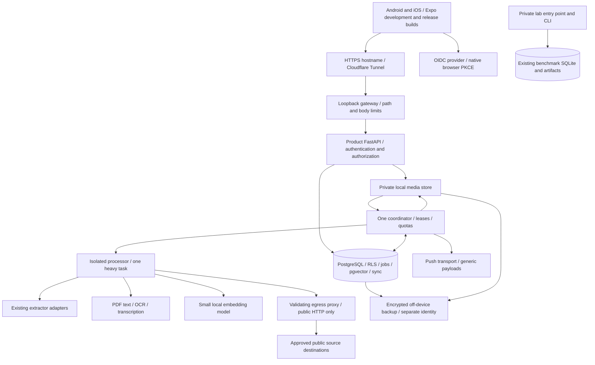

# RecallBox mobile and backend architecture

Proposed design, inspected 7 November 2026; baseline `c1ef5ed`. The current system is an extractor and private benchmark lab. This document changes neither its routing nor its storage. Feature coverage is defined in the [PRD](RECALLBOX_PRODUCT_PRD.md).

## Deployment shape

Use a Python modular monolith: one product FastAPI process, one coordinator/worker process, native PostgreSQL with pgvector, local private media files, and an isolated processing environment. PostgreSQL holds product transactions, the durable job queue and sync events. No Redis, Kafka, Kubernetes, vector server or standalone model-serving stack is needed. Ingress and worker isolation are distinct security boundaries.

There is no product-to-lab HTTP route, data mount or runtime credential path. Shared code is reusable, shared user data is not. Product extraction must not call the current `app:app` over HTTP.

## Exact reuse and change boundaries

| Existing module(s) | Reuse decision / reason |
|---|---|
| `models.py`, `service.py` | Reuse adapter/result concepts and normalization. Wrap in a product content-revision schema retaining truncation, source scope and provenance; `ExtractResponse` alone drops some adapter provenance fields. Preserve existing API compatibility. Product caller must add deadline and enforce installed/enabled engine policy |
| `router.py`, `categories.py` | Reuse platform/PDF hints; extension-based PDF detection is only a hint, validate actual media type. Current categories classify extraction cases, not a user's semantic labels. Product initially uses explicit HTML-first routing and optional heavy fallback; existing lab order remains unchanged |
| `adapters/html.py`, `fetcher.py` | Reuse bounded fetch and lightweight parser in isolated worker after egress controls. Add processor-level time/RSS/output constraints; HTML link lists and parser allocations are not bounded by content-character limit alone |
| `adapters/documents.py` | Reuse conversion result contract and killable child pattern; remote URL-only entry is insufficient for uploaded files. Add a narrow local verified-file processing interface; never pass an arbitrary filesystem path from a phone |
| `adapters/crawl.py`, `adapters/agent.py` | Preserve opt-in availability. Disable initially in public product until subrequest egress/process-tree isolation is proven. Agent Reach may use other backends: audit permitted channels; no personal session or credential inheritance |
| `security.py` | Reuse syntax/public-address checks as defense in depth. Known DNS validation-to-connect race; insufficient for a hostile user. Add actual connection pinning plus egress firewall and redirect/subresource controls before URL pilot |
| `resources.py` | Keep existing lab lock. It serializes non-HTML work only within one Python process; it is not a global memory budget or admission controller. Product needs DB scheduler lease and OS isolation |
| `config.py`, `capabilities.py` | Reuse extractor options/capability introspection internally; separate product settings with required secrets, identity audience, storage roots and fail-closed deployment mode. Current `/health` reveals too much for a public health route |
| `benchmark_runner.py`, `experiment_store.py`, `storage_v2.py` | Preserve untouched for lab: schema 3, local claims, snapshots and artifact lineage. Borrow design patterns, not the benchmark data model or PID-only recovery logic. Product tenancy and deletable user data conflict with immutable benchmark triggers |
| `benchmark_models.py`, `benchmarking.py`, `evaluation.py`, `scoring.py`, `data_export.py`, `cli.py` | Lab-only. Keep experiments, reference labels, AI reviews, score definitions and training exports independent. Paid evaluator remains off. No ML router training |
| `app.py` | Keep as private lab entry point on loopback. It initializes lab store and recovers benchmark work in lifespan and exposes benchmark/history/import/integrity/export endpoints with no auth. New product app must not import this module or mount its router |
| `pyproject.toml`, `.env.example`, scripts, existing docs | Keep extractor package/dependencies working. Add product optional dependency groups only in the slice needing them; pin/review releases then. Existing documentation/historical reports stay intact |

Inspected all Python modules and current architectural/schema/audit docs, benchmark dataset schema, prompts, CLI and helper scripts. No existing benchmark artifact bytes were available in this checkout to verify. Current base interpreter lacks FastAPI/HTTPX/BeautifulSoup/Pydantic, so application behavior was inspected from source, not rerun.

## Mobile structure and real native sharing

Proposed `apps/mobile` contains Expo Router screens, typed API client, feature modules, local SQLite outbox/cache, secure credentials and native integration configuration. Product Python code lives under `src/recallbox`; keep `src/universal_extractor` stable. Choose a supported Expo SDK and lockfile during S1 after checking native integration compatibility. Use local development builds, Android Studio/Xcode and real devices; avoid emulator + Xcode + heavy ingestion simultaneously on 8 GB.

Android handles SEND/SEND_MULTIPLE content URIs with temporary permissions; copy to private app storage before those grants expire. iOS requires an actual share extension and App Group inbox with bounded file copying, atomic handoff and a minimal native upload/capture flow. Main app drains the inbox after authentication. Extensions must finish quickly and never run OCR or depend on indefinite background execution.

Current [Expo sharing documentation](https://docs.expo.dev/versions/latest/sdk/sharing/) supports receiving but warns its iOS approach opens the main target in an unsupported way. Therefore validate the pinned SDK and use a supported native share-controller extension for reliable iOS release behavior. A config plugin/custom native target is expected; Expo Go is insufficient evidence. Cold start, killed app, locked device, multiple files and expired auth are explicit manual cases.

Outbox operations use durable UUID client operation IDs, content checksums and retry states (`local_pending`, `uploading`, `server_accepted`, `processing`, `ready/partial/failed`). Never delete a local original before server finalization. Upload parts are resumable, idempotent and account-owned. SecureStore holds refresh tokens and cache-encryption keys; access tokens stay in memory. [SecureStore](https://docs.expo.dev/versions/latest/sdk/securestore/) has platform-specific persistence/backup behavior, so logout/reinstall and biometric changes require verification. Encrypt sensitive local cache files with a maintained native solution; ordinary SQLite is not encrypted merely because credentials use SecureStore.

## Identity and authorization

Proposed initial identity source: OIDC authorization code through the system browser with PKCE and verified app/universal links. The app is a public client with no embedded secret. This follows [RFC 8252](https://www.rfc-editor.org/rfc/rfc8252). Provider selection, availability and any associated cost/privacy terms remain a decision gate; no provider is provisioned here. Avoid a heavyweight identity server on this host.

Backend exchanges a provider-issued credential intended for its configured client/audience at `/auth/exchange`; validate signature algorithm allowlist, issuer, audience, expiry and login transaction nonce where applicable. Key lookup is bounded/cached and fail-closed. Map `(issuer, subject)` to an internal UUID, never trust email alone. Issue a 10-minute product access token plus opaque rotating refresh token stored hashed in PostgreSQL. Rotation is atomic, token reuse revokes its family, and logout/account deletion revokes sessions. Access validation also checks session revocation so deletion is immediate. Provider client IDs, exchange flow and app redirect ownership must be validated together before S1 acceptance.

Every handler derives the owner from authenticated context, checks resource ownership and applies DB RLS; ignore body `owner_id`. Return uniform not-found for someone else's resource. Exports, sync cursors, counts, notifications and binary downloads have the same rules. Migration and runtime roles are separate. A worker is a trusted coordinator with scoped DB functions; hostile parser children receive no DB credentials, refresh tokens, personal files or benchmark mounts.

## Ingestion and processing

A save transaction inserts memory, initial revision, job, quota reservation, idempotency record and sync event. Respond 202 only after commit. Small notes can become ready within that transaction. Worker claims a ready job with `FOR UPDATE SKIP LOCKED`, writes an expiring lease and commits before processing; no transaction held across network/model work. Durable leases, heartbeats, fencing generation and version-checked publish prevent stale workers from overwriting current/deleted memories.

Stages: fetch/validate or assemble upload → extract text → OCR/captions/transcribe when needed → chunk → embed → classify → index → ready/partial and notify. Persist stage boundaries and per-stage revision keys. Errors distinguish unsupported format/language, source restriction, timeout, memory limit and retryable network issues. Retry at most three attempts with exponential backoff/jitter; permanent unsafe input never retries. Interrupted jobs retain source and prior outputs; stage replay is idempotent. See DB document for transaction details.

Light tools proposed: PDF text via a bounded local PDF parser; [Tesseract](https://tesseract-ocr.github.io/tessdoc/Command-Line-Usage.html) for screenshots/scanned pages; FFmpeg for bounded audio decoding; [whisper.cpp](https://github.com/ggml-org/whisper.cpp) tiny/base multilingual for speech. These are candidates requiring ARM64 install/license and fixture verification, not installed capabilities. Processing children have no network for local files. One heavy task across OCR, transcription, embeddings and browser work, with wall/RSS/output/page/pixel/duration caps. Unload models between incompatible phases. Docling/browser fallback stays optional if measured within budget. Supported uploaded-video transcription is required for full release even if social URL transcripts remain explicitly unsupported.

Local embeddings candidate: `intfloat/multilingual-e5-small`, 384-dimensional, with `query:` / `passage:` prefixes, bounded token chunks, normalization and pinned model revision. Its [model card](https://huggingface.co/intfloat/multilingual-e5-small) defines input behavior; no model download was performed. Start around 350 tokens/chunk with 50 overlap, validated against the tokenizer limit. Store model/version per vector. Benchmark quality on intended English/Hindi material and OCR noise before release. Prefer a measured ONNX CPU build if compatible; do not assume quantized model quality/RAM. Query embeddings enter a short high-priority lane on the same model runner, while long media phases checkpoint/yield. If inference is unavailable, report keyword-only mode explicitly.

PostgreSQL GIN full-text indexes plus owner-filtered exact pgvector search initially; combine ranks with reciprocal rank fusion, collapse chunks to memories, and return source excerpts. Query model must match stored model/dimension; re-embedding creates a new version before switching search. [pgvector](https://github.com/pgvector/pgvector) provides exact search by default; add approximate indexes only after measured scoped-query latency/recall warrants their memory cost.

Recipes parse actual Recipe structured data or editable ingredient/step forms; plans and learning queues are deterministic organizers of chosen source material. Every derived field has provenance or is marked user-entered. A large local generative model is not in the baseline RAM plan. These services produce real persistent usable actions without placeholder AI prose.

## Sync, storage, push and operations

Store UTC timestamps plus IANA timezone for travel/reminders. Immutable content revisions and optimistic integer entity versions support conflict review. Client mutations include expected version; server returns 409 plus current version, preserving unsent text for user reconciliation. Sync change sequence is serialized per owner in the mutation transaction so committed cursor order cannot skip an uncommitted earlier event. Retain tombstones 30 days; older cursors receive 410 and full resync instructions. Server deletion defeats stale edits; clients purge deleted caches.

Local media is outside the repository/web root under opaque account/asset IDs, mode 0700 directories/0600 files. No static media mount, public bucket or raw filesystem paths. Authenticated range downloads implement bounded reads, safe Content-Disposition and `nosniff`; originals are never executed as HTML. Reconcile file/DB publication with durable staged uploads and orphan cleanup. Include assets, DB, model/config manifests and deletion ledger in encrypted restore planning.

Use durable notification outbox and APNs/FCM transport through a reviewed adapter; Expo push relay is optional after privacy/provider review. No paid API is enabled by this plan. Device push credentials and physical-device builds are prerequisites ([Expo setup](https://docs.expo.dev/push-notifications/push-notifications-setup/)). Polling sync/in-app notifications remain reliable fallbacks, not a claim that push has shipped.

Monitor resource pressure, storage reservations, API latency/errors, queue age, lease expiry, unsafe-fetch rejects, notification failures and backup age/restore results. Start with bounded structured logs and a small private status command rather than Prometheus/Grafana. Redact authorization, cookies, tokens, source bodies and credential-bearing URLs. Hosting trust boundaries, memory estimates and deployment blockers are in [the host plan](MAC_M2_HOSTING_PLAN.md).
