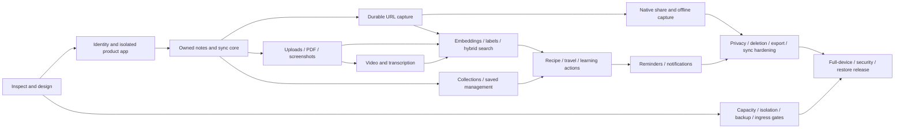

# RecallBox implementation slices and release gates

Status 7 November 2026, baseline `c1ef5ed`: architecture/host-assessment deliverables completed; full product not implemented. This is a sequence of small functional slices with reviewable commits. No entire-app generation, router training, paid API activation or new automated test suite. Use manual smoke checks during prototype development; rigorous security/privacy/isolation/end-to-end verification is mandatory before external release.

## Current change and verification boundary

This change adds five architecture documents and a standard-library read-only host inventory script. It does not alter extractor modules, benchmark schema, artifacts, scoring, engine routing or dependencies. No tunnel, system setting, native client, DB, login or public service is created. Existing benchmark storage is absent in this checkout; historical audit results are not treated as fresh verification.

Current host: Apple M2 / 8 GiB, approximately 20 GiB disk available, significant memory compression, some swap. Python product/extractor runtime packages are absent from the current interpreter. PostgreSQL/container/cloudflared commands absent from PATH. Architecture readiness is not deployment readiness. [Hosting plan](MAC_M2_HOSTING_PLAN.md) contains observations, uncertainty and remediation gates.

## Dependency order

All branches converge before the full release. Some work can be implemented sequentially in another order, but account/ownership, durable save and worker-isolation dependencies cannot be skipped. No phase is a public-release authorization merely because it has a number.

## Small functional slices and suggested commits

Each slice can use the listed implementation and verification commits; keep each diff focused and record actual observations, device/build/config identity and remaining limits. Do not claim completion based on a UI mock or API stub.

| Slice | Functional result / small commits | Manual smoke and acceptance evidence |
|---|---|---|
| S0 — this change | `docs: define complete mobile scope and Mac hosting gates`; `chore: add passive host inventory` | Read actual modules; inventory normal/denied-command behavior; validate documentation links and Python syntax; no runtime feature claim |
| S1 — product boundary + identity | `feat: add separate product app and validated product settings`; `feat: add PostgreSQL users and sessions`; `feat: sign in through native OIDC browser flow` | Product startup never imports lab app/creates `.benchmark_lab`; only minimal health and real auth routes; invalid/missing/expired/wrong-audience tokens rejected; actual sign-in/logout/refresh on both devices; fail closed when provider/DB unavailable |
| S2 — private notes | `feat: persist owned notes with idempotent saves`; `feat: add mobile inbox and note editor`; `feat: add versioned changes feed` | Account A saves/edits note, restarts API and phone, reads on second device; B cannot access IDs, lists, counts or sync; duplicate retry creates one item; conflicting edit returns 409 without losing local draft |
| S3 — real URL ingestion | `feat: add leased ingestion queue and owned job status`; `security: isolate fetch processor and pin egress DNS`; `feat: save and display attributed URL content` | Safe public article becomes real text; source restriction/unsupported/PDF cases truthful; server kill/restart replays safely; deletion before completion prevents publish; protected-network sentinel untouched on rebinding/redirect/bypass cases. No public URL ingestion before this security evidence |
| S4 — native capture | `feat: add Android share intents and durable outbox`; `feat: add supported iOS share extension`; `feat: resume capture after offline interruption` | Real share sheet from browser/files/photos on physical Android/iOS, app killed/cold start, multiple items, offline/retry/auth expiry; duplicate operation one server record; originals retained until confirmed finalization |
| S5 — private files and OCR | `feat: add bounded resumable uploads and private downloads`; `feat: extract PDF text and screenshot OCR`; `feat: show source pages and partial coverage` | Interrupted/mismatched part, renamed file, oversized/decompression/pixel/page bombs and path traversal rejected; text PDF/scanned PDF/screenshot yields actual evidence; unauthorized asset/range access fails; scratch/file quota survives restart |
| S6 — video | `feat: decode bounded media and transcribe locally`; `feat: display timestamped transcript and honest source status` | Small authorized uploaded clip with speech becomes usable transcript; silence/unsupported language/corrupt codec/no captions handled honestly; timing/word accuracy manually compared; child timeout kills descendants and leaves API responsive |
| S7 — search / organization | `feat: chunk and embed with pinned local model`; `feat: add owner-scoped keyword and semantic search`; `feat: suggest labels with user overrides` | Real queries find known items absent literal keywords; keyword filters correct; source snippets map to real pages/time; multilingual/noisy fixtures; B never sees A via search/count; model migration/deletion never exposes old revision; record quality/latency and pressure |
| S8 — organization UI | `feat: add private collections and membership`; `feat: sync starred archived and reordered items` | CRUD, multi-device edits, duplicate membership, unauthorized linking, empty/deleted collection, offline conflicting reorder and pagination |
| S9 — all action modes | `feat: parse grounded recipes and persist shopping progress`; `feat: build editable source-linked travel itineraries`; `feat: add learning queues and completion` | Recipe source/quantity/servings scaling verified, no inferred missing quantities; itinerary day/timezone editing and real source links; learning order/progress persist on second device; all sources ownership checked; missing data requests user input |
| S10 — reminders / notifications | `feat: add timezone-aware reminder scheduler and outbox`; `feat: register devices and deliver private notifications` | Real APNs/FCM delivery and receipt handling; quiet hours/DST/permissions/revoked token/offline/device logout; tapping generic payload resolves only after account auth; no source text in payloads/logs; duplicate send deduplication where transport permits |
| S11 — privacy and robust sync | `feat: export owned data and purge memories/accounts`; `feat: add consented extraction feedback`; `fix: reconcile expired cursors and deletion races` | Primary and derivative deletion within deadline; caches cleared, sessions revoked, jobs cannot republish; export only A data and expires; restored backup applies deletion ledger; long-offline device fully resyncs without resurrecting deleted data |
| S12 — complete release | `ops: add reviewed launchd and backup manifests`; `security: verify full route and network boundaries`; `docs: record signed-off device and recovery evidence` | Every PRD row passes both-platform end-to-end walkthrough; host workload/soak/restore gates pass; ingress enabled only after local prerequisites; finalize rollout/operator runbook |

S1 is the smallest next implementation unit; complete its small commits locally before adding URL work. S2 is the first useful account-to-device product slice. Neither needs an OCR/LLM/browser installation. Do not implement placeholder endpoints for later slices. Reuse current extractor imports directly in S3 only behind the worker adapter boundary; keep private lab interfaces intact.

## Decisions before dependent implementation

- Select OIDC provider, native redirect ownership and provider credentials; validate privacy/availability and any costs. No paid provider or AI API approval is implied.
- Confirm domain/Cloudflare account and backup target/key custodians before ops setup. Do not purchase or publish in this design task.
- Choose supported Expo SDK/native extension integration and local build tooling, plus Apple/Android signing/push credentials and physical devices. Distribution account costs need explicit decision.
- Allocate disk space/quiet-host operating window and choose measured ARM64 isolated processor runtime. No global host changes or downloads bundled into a docs change.
- Establish supported input languages/quality fixtures, model artifact/license hashes and initial media limits. Start with English/Hindi evaluation; unsupported cases must be clearly exposed until validated.

## Pre-ingress gate: every item blocks public tunnel creation

1. Separate product executable with exact intended route list, public docs/debug disabled, lab absent; private benchmark data not in mounts/logs/backups exposed to product users.
2. Real accounts, signature/audience/issuer/session checks, rotating refresh/revocation, per-user authorization, RLS/role grants and composite FKs verified with at least two accounts. An authenticated user cannot query another user's metadata, files, jobs, search, sync, exports or action sources.
3. DNS-pinned proxy plus enforceable worker isolation pass protected-sentinel tests for IP encoding/IPv6/mixed DNS/rebinding/redirect/subresource/proxy bypass, and filesystem/secret access. Parser children cannot reach DB, host/LAN, credentials or personal browser data.
4. Byte/time/CPU/RAM/PID/file/page/pixel/duration limits verified; gateway body limits occur before app parsing; per-owner/global quotas and disk reservations survive retries/concurrent requests and restart.
5. Durable leased queue, kill/restart/reclaim/cancel/delete races, fencing and stale publication checks pass. Heavy work cannot crash or block the API; dead jobs remain inspectable.
6. At least 30 GiB free allocated storage before pilot; measured quiet-host memory headroom, one-heavy-task behavior, sustained network upload/download and ISP interruption recovery documented. No persistent pressure/swap growth under target workload.
7. Secrets stored outside Git with service identity permissions, private authenticated downloads, content-free log review, encrypted off-device backup and clean restore verified. Deletion ledger applied on restore.
8. Intended hostname/gateway/tunnel configuration reviewed and validated without connecting; deny catch-all, normalization, exact routes, trusted proxy headers and private origin binds verified. No router forwarding. Only then explicitly proceed with the authorized deployment scope; this document itself creates no tunnel.

For a private local prototype, gates can be developed progressively with loopback-only access. That does not waive them for an external phone/URL pilot.

## Full external release gate

All PRD features—not just extraction—must have actual evidence. Run a full walkthrough: sign up/sign in → native share each supported type → see truthful extraction/OCR/transcript → correct labels → search semantic and keyword → collect/star/archive → make recipe, travel and learning actions → reminder delivered → edit on second device → resolve offline conflict → export → delete memory/account → restore backup without resurrection.

Required additional evidence:

- Both physical platforms, production-like builds, real identity and push credentials; accessibility/dynamic type/dark mode; permission denial and app lifecycle interruptions.
- Schema upgrades fresh/from prior revision, rollback strategy, DB outage, storage exhaustion, corrupt files, service crash, laptop sleep/wake/reboot/unlock and ISP outage. Log evidence and known availability limits; no claim of HA on one laptop.
- Capacity: measure metadata p95 <500 ms and search p95 <1 s on 10,000 realistic memories while a bounded heavy job runs; exercise 5-account pilot quotas and sustained queue backpressure. At least 24-hour soak without unbounded RAM/WAL/scratch growth, plus real largest-allowed media cases. Targets can be revised with reasons before public promises.
- Privacy: account A/B adversarial probes across every route; recent reauth for export/account delete, old-token revocation, no private payload/log/cache leak, orphan cleanup and delete-during-upload/processing/search reindex cases.
- Security: review auth redirects/token exchange/key rotation, dependency/model provenance, upload parsing, SQL bindings, RLS grants, proxy bypasses and process escape paths. Record an independent review before wider rollout. No new automated suite during rapid prototyping; verification rigor and recorded evidence remain required.
- Recovery: successful encrypted off-device snapshot, clean restore with media/hash checks, RPO ≤24h / RTO ≤8h demonstrated; deletion ledger and backup 30-day expiration checked. Monitor alerts and named operator responsibilities exercised.

## Evidence record format and rollout

For each gate, record date/timezone, Git SHA, migration/model/native-build versions, devices/OS, exact manual steps, expected/observed outcome, content-free logs/screenshots, PASS/FAIL/BLOCKED, reviewer and limitations. Store raw accounts/tokens/private fixtures outside Git; commit only sanitized summaries. A failed/unmeasured gate remains open; historical benchmark scores are not product acceptance results.

Rollout stages: local-only foundations → gated invite-only full-feature pilot after applicable ingress gates → full release after all scope/security/recovery gates. Stop new admissions on capacity/privacy/security failure; keep authenticated reads/deletion where safe. Rollback code to a compatible revision, pause bad workers and retain user data; do not restore an old DB over newer data without a reviewed recovery procedure.

## Verification performed for this planning change

Repository source inspection, passive host inventory (sandboxed and unrestricted read-only runs), documented primary-source technology checks, and syntax/link/diff smoke checks are the scope. Final checks passed: inventory script AST syntax, passive JSON execution, complete unrestricted process inventory without truncation, Markdown fence balance and relative links, and Git whitespace diff check. The missing optional runtime commands were reported as unavailable; active network measurement remained disabled. No runtime product feature, automated suite, media processing, public tunnel, backup restore or real mobile end-to-end run is claimed completed.
